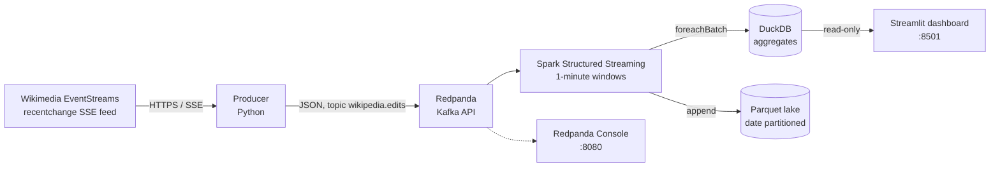
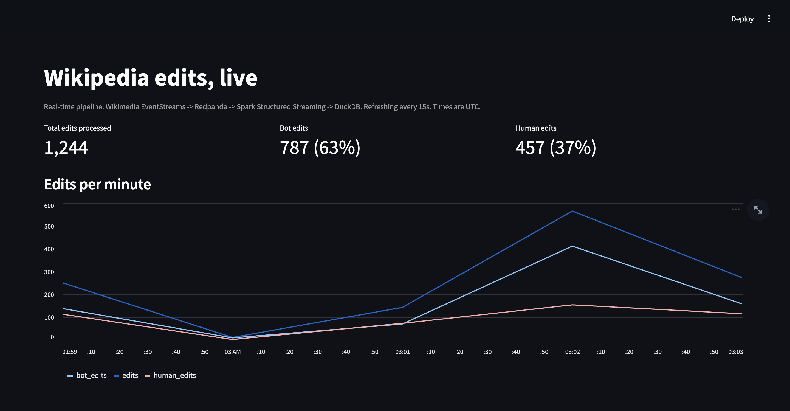
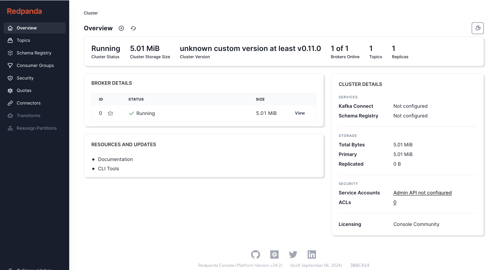

# Wikipedia Edit Ingest

A real-time streaming pipeline that ingests every Wikipedia edit as it happens, aggregates it with Spark Structured Streaming, and serves it to a live dashboard.


Wikipedia is edited roughly 250,000 times a day across 300+ language editions. This project taps the public Wikimedia EventStreams feed, normalizes the events, streams them through Redpanda (Kafka API), computes per-minute analytics in Spark, stores aggregates in DuckDB and raw events in a Parquet data lake, and visualizes everything in Streamlit. The whole stack starts with one `docker compose up`.

## Architecture



## What it demonstrates

- **Streaming ingestion** from a real, unbounded source: an SSE firehose with reconnects, exponential backoff, and graceful shutdown.
- **Kafka-style event streaming** with Redpanda, keyed by wiki so all edits for one wiki land on the same partition.
- **Structured Streaming aggregations**: 1-minute tumbling windows with a watermark, bot vs human splits, byte-change statistics, and top-N rankings per window.
- **Idempotent sink writes**: DuckDB tables are written with delete-then-insert per window via `foreachBatch`, so micro-batch retries never duplicate data.
- **A small data lake**: curated events written to Parquet, partitioned by event date.
- **A serving layer** that reads the aggregates read-only and refreshes on a fragment timer.
- **Testable stream logic**: parsing and aggregation semantics live in a shared `common` package and are unit-tested with pytest, no live services required. The pandas implementations in `common/aggregations.py` mirror the Spark aggregations one for one.

## Quickstart

Prerequisite: Docker with the Compose plugin.

```bash
docker compose up --build
```

Then open:

- Dashboard: http://localhost:8501 (aggregates appear within about a minute)
- Redpanda Console: http://localhost:8080 (watch the `wikipedia.edits` topic fill up)

Stop it with `docker compose down`. Data lives on a named volume, so aggregates, Parquet files, and Spark checkpoints survive restarts.

Useful targets: `make up`, `make down`, `make logs`, `make test`, `make lint`.

## What the dashboard shows

- Total edits processed, with the bot vs human split
- Edits per minute over time
- Top edited pages and top editors for the latest minute
- Top wikis by total edits

## Project structure

```
.
├── common/                 Shared, tested logic
│   ├── events.py           recentchange parsing + normalization (WikiEdit)
│   └── aggregations.py     Pandas mirror of the Spark aggregations
├── producer/               SSE -> Kafka producer (Python, kafka-python)
├── streaming/              PySpark Structured Streaming job -> DuckDB + Parquet
├── dashboard/              Streamlit app reading DuckDB read-only
├── tests/                  pytest suite (parsing, schema, aggregations)
├── docker-compose.yml      The whole pipeline
└── data/                   Runtime output (gitignored): duckdb/, parquet/, checkpoints/
```

## Design decisions and trade-offs

**Redpanda instead of Apache Kafka.** One container, no ZooKeeper or KRaft ceremony, and still the Kafka API, so the producer, Spark connector, and console tooling are unchanged. For a single-node pipeline the operational simplicity wins; the trade-off is that this is not how a multi-broker production cluster would be run.

**Spark for aggregation, DuckDB for serving.** Spark Structured Streaming handles the stateful windowed aggregation and both sinks in one job. DuckDB is used as an embedded serving store rather than a warehouse: the dashboard gets SQL over a local file with zero extra infrastructure. DuckDB allows one writer alongside read-only readers, and a read can occasionally collide with a write checkpoint, so the dashboard retries queries briefly instead of crashing. At this data volume (a few thousand rows of aggregates per hour) that is a fine trade. At higher throughput I would swap the serving layer for a real OLAP store or write aggregates to Parquet and query those.

**Idempotent DuckDB writes.** Windowed aggregation queries run in update mode with `foreachBatch`. Each micro-batch deletes the rows for the windows it touches before inserting, keyed on `window_start`. That makes replays and checkpoint recoveries safe without needing exactly-once plumbing between Spark and DuckDB.

**Normalization at the edge.** The producer flattens the nested recentchange JSON into a fixed schema (`WikiEdit` in `common/events.py`) before anything touches Kafka. Downstream consumers never see feed quirks: missing lengths, absent revision ids, non-edit event types. The schema is pinned by a unit test, and the Spark job declares the matching struct.

**Top-N in Spark, not in the dashboard.** Top pages and editors are ranked per window inside the stream (window function over each micro-batch's counts), so the dashboard is a dumb reader. Window functions on streaming DataFrames only see the current micro-batch, which is exactly the data a per-window ranking needs in update mode.

**Events keyed by wiki.** Partitioning by wiki keeps per-wiki ordering and locality. The feed is only about 2 edits/second on average, so a single partition would also work; keying by wiki is the layout that scales to filtered or higher-volume variants of this pipeline.

**Parquet layout.** Curated events are written with the standard streaming Parquet sink, partitioned by event date. Small files are a known wart of streaming sinks at low volume; a production version would add periodic compaction.

## Running the pieces locally (without Docker)

The tests need only pandas and DuckDB:

```bash
pip install pytest pandas duckdb
python -m pytest tests/ -q
```

The producer can run against a local Redpanda (from `docker compose up redpanda console`) using the external listener:

```bash
cp .env.example .env
pip install -r producer/requirements.txt
python producer/producer.py   # KAFKA_BROKER defaults to localhost:19092
```

## Screenshots

<!-- TODO: add screenshots once you have run the pipeline locally -->
<!--  -->
<!--  -->

_Placeholder: run `docker compose up`, let it collect a few minutes of edits, and drop screenshots of the dashboard and the Redpanda Console topic view here._

## Future improvements

- Filter or sample the firehose per wiki (for example, English Wikipedia only) and compare volumes across editions.
- Detect edit wars: pages with rapid revert cycles, using revision history within a session window.
- Add a schema registry and move from JSON to Avro or Protobuf on the topic.
- Compact the Parquet lake and add a batch backfill job that recomputes aggregates from the lake to verify the streaming numbers.
- Alerting on stream lag and edit-rate anomalies.

## Tech stack

Python 3.11, Wikimedia EventStreams (SSE), Redpanda, Apache Spark 3.5 (Structured Streaming), DuckDB, Parquet, Streamlit, Docker Compose, pytest, ruff, GitHub Actions.
